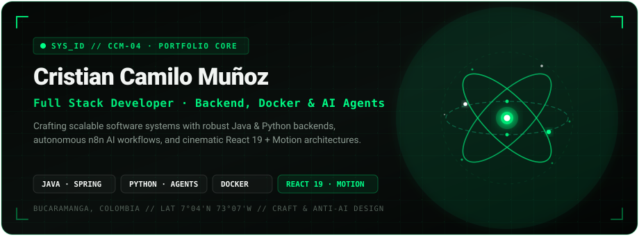

<p align="center">
  
</p>

<p align="center">
  <a href="https://cristixn04.github.io/">
    
  </a>
  <a href="https://github.com/Cristixn04/Cristixn04.github.io/actions/workflows/deploy.yml">
    
  </a>
  
</p>

<p align="center">
  
  
  
  
  
  
  
  
</p>

---

## 🧭 Resumen Ejecutivo

Sitio web personal y portafolio interactivo de ingeniería de software de **Cristian Camilo Muñoz Rodríguez** ([`cristixn04.github.io`](https://cristixn04.github.io/)). Construido desde cero bajo los más altos estándares de **Craft y Design Engineering** (*Emil Kowalski*), con una estética inspirada en consolas cibernéticas y sistemas oscuros de alta precisión (**Dark Obsidian** `#060807` y acentos **Verde Esmeralda** `#00e575`).

El proyecto combina una arquitectura frontend reactiva en **React 19 LTS** y **Vite**, micro-interacciones físicas a 60/120 FPS mediante **Motion** (`motion.dev`), escenas matemáticas paramétricas con **Three.js** y un sistema bilingüe reactivo sin dependencias externas pesadas.

---

## ⚡ Hitos y Características Arquitectónicas

### 1. 🌌 Esfera de Partículas Motion & Transición Cinemática Supernova
- **Esfera de Partículas Interior**: Inspirada en el modelo de partículas de Motion con núcleo cuántico de átomo React orbitante.
- **Respuesta Táctil & Puntero**: Al mover el cursor a través del átomo, las partículas se desensamblan elásticamente en la zona de contacto y retornan suavemente por atracción magnética al salir.
- **Transición Determinista en 3 Fases**:
  1. *Explosión contenida*: Dispersión radial de partículas conservando visibilidad dentro del viewport.
  2. *Reunión gravitacional*: Colapso cinemático de los nodos en un núcleo radiante central.
  3. *Emergencia en cascada*: Formación armónica de la interfaz y elementos del Hero.

### 2. 🎬 Galería 3D Motion Coverflow Film Reel (Proyectos Destacados)
- **Escenario 3D Widescreen sin Marcos**: Desencapsulado horizontal completo que permite a las tarjetas respirar en el canvas general con perspectiva espacial (`perspective: 1100px`, `transform-style: preserve-3d`).
- **Desplazamiento Continuo por Arrastre (Click & Drag-to-Scroll)**: Navegación horizontal en tiempo real con `Pointer Events` y captura de puntero a 60/120 FPS (`setPointerCapture`), además de soporte fluido para desplazamiento con rueda del ratón y trackpad.
- **Física de Resortes**: Transiciones con amortiguación inercial (`stiffness: 300, damping: 30`), rotación de tarjetas laterales a $\pm 38^\circ$ y atenuación de brillo cinemático.
- **Cue Sheet Monospace**: Panel inferior técnico interactivo con celdas de proyecto activadas con acento esmeralda radiante.

### 3. 🎯 Cursor Cinético Multi-Follow de Motion
- **Punto Guía Central (Lead Pointer)**: Círculo blanco nítido (`#ffffff`, 6px) con aura esmeralda y seguimiento instantáneo en `(clientX, clientY)`, garantizando cero latencia en el clic.
- **Estela Elástica de 3 Anillos Concéntricos**:
  - *Anillo Interior (18px)*: Menta neón (`#00ff88`, `stiffness: 500, damping: 28, mass: 0.35`).
  - *Anillo Intermedio (28px)*: Verde esmeralda signature (`#00e575`, `stiffness: 320, damping: 24, mass: 0.60`).
  - *Anillo Exterior (40px)*: Verde jade profundo (`#10b981`, `stiffness: 180, damping: 20, mass: 0.95`).
- **Micro-interacciones y Estados**: Dilatación al pasar sobre elementos interactivos (`scale: 1.35`) y compresión elástica instantánea en clic (`scale: 0.65`).
- **Gating de Hardware**: Confinado exclusivamente a dispositivos con ratón fino (`@media (hover: hover) and (pointer: fine)`). En pantallas táctiles móviles no renderiza nada ni consume recursos.

### 4. 🌐 Fondo Ambiental Motion con Micro-Partículas & Malla Cyber
- **Activación Progresiva**: Inicia suavemente al entrar a la sección de **Perfil Profesional** (`#sobre-mi`) y acompaña el resto de la web (`Proyectos`, `Habilidades`, `Educación`, `Contacto`).
- **Suspensión en Hero (0% Consumo)**: Mientras el usuario está en el Hero, el bucle de animación de fondo permanece apagado (`opacity: 0`), priorizando el rendimiento para Three.js.
- **Micro-Partículas y Constelación**: Partículas flotantes sutiles con respiración armónica de opacidad, enlaces tenues de proximidad técnica (< 105px) y repulsión orgánica ante el cursor.

### 5. 🪐 Escena 3D Paramétrica en Three.js con Nodos Circulares Luminosos
- Malla de alambre geométrica (Icosaedro interior + Dodecaedro exterior) con seguimiento inercial de mouse.
- **Nodos Suaves**: Textura procedural radial generada en canvas con mezcla aditiva (`AdditiveBlending`) que convierte los puntos en partículas de energía perfectamente redondas y radiantes.
- **Desensamblaje por Scroll**: Al hacer scroll hacia abajo, la geometría se desensambla dispersando sus partículas en el espacio y se reensambla elásticamente al volver a la cima.

### 6. 🌍 Internacionalización Bilingüe Reactiva (ES / EN)
- Proveedor de contexto ligero (`LanguageContext.jsx`) con conmutación en tiempo real de todos los contenidos técnicos, métricas, proyectos y etiquetas, con persistencia en `localStorage`.

---

## 🛠️ Stack Tecnológico

| Capa / Dominio | Tecnologías | Propósito / Características |
| :--- | :--- | :--- |
| **Frontend Core** | React 19 LTS, Vite 8, JavaScript ES6+ | Renderizado de alto rendimiento y arquitectura modular |
| **Motion & Física** | Motion 14 (`motion.dev`), Springs | Transiciones físicas inerciales y micro-interacciones |
| **3D & Canvas** | Three.js, Canvas 2D Procedural | Escenas paramétricas, texturas radiales y partículas |
| **Backend & APIs** | Java (Spring Boot), Python, Node.js | Arquitecturas escalables, APIs REST y microservicios |
| **Bases de Datos** | PostgreSQL, MySQL | Modelado relacional estructurado, normalización y ACID |
| **DevOps & Cloud** | Docker, Docker Compose, Git, GitHub Actions | Contenerización de entornos y despliegue continuo |
| **Automatización & IA** | n8n, Agentes IA con Python | Automatización de flujos de trabajo e integración LLM |
| **Tipografía & Tokens** | Space Grotesk, JetBrains Mono | Jerarquía tipográfica técnica y legible |

---

## 📂 Estructura del Proyecto

```text
Cristixn04.github.io/
├── .github/
│   └── workflows/
│       └── deploy.yml              # Pipeline automatizado de CI/CD para GitHub Pages
├── public/
│   ├── docs/
│   │   └── CV_Cristian_Munoz.pdf   # Hoja de vida oficial descargable (Español / Inglés)
│   ├── img/
│   │   ├── banner.svg              # Banner SVG animado con orbitales y gradientes
│   │   ├── profile.png             # Fotografía oficial enmarcada con HUD cyber
│   │   ├── opscenter.png           # Captura real Campuslands OpsCenter
│   │   ├── rentatools.png          # Captura real RentaTools Marketplace
│   │   └── paddock.png             # Captura real Paddock Global F1
│   ├── .nojekyll                   # Bypass de procesamiento Jekyll para GitHub Pages
│   └── 404.html                    # Manejador SPA de redirecciones y rutas limpias
├── src/
│   ├── components/                 # Componentes de interfaz modulares y autónomos
│   │   ├── About.jsx               # Perfil profesional y dominio de idiomas (Bilingüe)
│   │   ├── AmbientBackground.jsx   # Fondo ambiental de micro-partículas y malla cyber
│   │   ├── Contact.jsx             # Canales de comunicación directa y formulario
│   │   ├── Education.jsx           # Trayectoria y acreditaciones con iluminación scroll
│   │   ├── Footer.jsx              # Pie de página técnico y derechos de autor
│   │   ├── Hero.jsx                # Portada, tarjeta HUD con coordenadas y métricas
│   │   ├── HeroScene.jsx           # Escena 3D Three.js con dispersión de partículas
│   │   ├── Icons.jsx               # Iconos vectoriales limpios (GitHub, LinkedIn)
│   │   ├── IntroSplash.jsx         # Bienvenida interactiva Motion Orb y transición supernova
│   │   ├── MultiFollowCursor.jsx   # Cursor cinético con 3 anillos concéntricos esmeralda
│   │   ├── Navbar.jsx              # Barra de navegación con layoutId e idiomas
│   │   ├── ProjectCarousel.jsx     # Coverflow Film Reel 3D con arrastre continuo y Cue Sheet
│   │   ├── ProjectModal.jsx        # Modal de inspección de arquitectura (Portal a body)
│   │   ├── Projects.jsx            # Catálogo filtrable por categorías con scroll táctil
│   │   ├── ScrollProgress.jsx      # Barra de progreso ligada al scroll en degradado
│   │   ├── Skills.jsx              # Matriz de 11 tecnologías oficiales del CV
│   │   └── SoftSkills.jsx          # Competencias blandas oficiales verificadas
│   ├── data/
│   │   └── projects.js             # Ficha técnica y arquitectura de proyectos destacados
│   ├── i18n/
│   │   ├── LanguageContext.jsx     # Contexto reactivo para alternancia de idioma
│   │   └── translations.js         # Diccionario completo ES / EN sincronizado con el CV
│   ├── styles/
│   │   └── index.css               # Tokens de diseño, reset, gating de cursor y animaciones
│   ├── App.jsx                     # Componente raíz y orquestador del layout
│   └── main.jsx                    # Punto de entrada de React 19
├── index.html                      # Plantilla HTML con preloads de fuentes y metadatos
├── package.json                    # Dependencias oficiales y scripts de compilación
├── pnpm-lock.yaml                  # Lockfile determinista con pnpm 12
├── vite.config.js                  # Configuración de Vite y chunk splitting
└── README.md                       # Documentación técnica del repositorio
```

---

## 🚀 Instalación y Desarrollo Local

### Requisitos Previos
- **Node.js**: `v20.0.0+` o `v22.0.0+`
- **Gestor de Paquetes**: `pnpm v10+` o `v12+` (recomendado) o `npm`

### Pasos de Ejecución
```bash
# 1. Clonar el repositorio
git clone https://github.com/Cristixn04/Cristixn04.github.io.git
cd Cristixn04.github.io

# 2. Instalar dependencias con pnpm
pnpm install

# 3. Iniciar el entorno de desarrollo local con Vite (HMR)
pnpm run dev

# 4. Compilar para producción (Zero warnings / Zero errors)
pnpm run build

# 5. Previsualizar el bundle de producción localmente
pnpm run preview
```

---

## 🌐 Configuración de Despliegue en GitHub Pages

El portafolio se compila y publica de forma continua en:
👉 **[https://cristixn04.github.io/](https://cristixn04.github.io/)**

- **Automatización CI/CD**: Cada push a la rama `main` activa `.github/workflows/deploy.yml`, el cual compila los recursos estáticos con Vite y publica `./dist` en GitHub Pages.
- **Rutas Relativas**: `vite.config.js` está configurado con `base: './'` para resolución determinista de chunks, fuentes e imágenes.
- **Archivo `.nojekyll`**: Presente en `public/` para evitar que el motor de Jekyll omita archivos con prefijo guión bajo o directorios de assets.
- **Fallback SPA (`404.html`)**: Permite que cualquier intento de acceso directo o recarga de ruta se redirija adecuadamente sin pantallas de error 404 del servidor.

---

## 👤 Perfil del Desarrollador & Contacto

**Cristian Camilo Muñoz Rodríguez**  
*Desarrollador Full Stack · Backend, Docker & Agentes IA*  
Bucaramanga, Santander, Colombia (7°04'N 73°07'W)

- 🌐 **Portafolio Oficial**: [cristixn04.github.io](https://cristixn04.github.io/)
- 💼 **LinkedIn**: [linkedin.com/in/cristian-muñoz-159980489](https://www.linkedin.com/in/cristian-mu%C3%B1oz-159980489/)
- 🐙 **GitHub**: [@Cristixn04](https://github.com/Cristixn04)
- 📧 **Correo Electrónico**: [cristiancamilomunozrodriguez@gmail.com](mailto:cristiancamilomunozrodriguez@gmail.com)
- 💬 **WhatsApp**: [+57 311 496 0776](https://wa.me/573114960776)

---

<p align="center">
  <sub>© 2026 Cristian Camilo Muñoz Rodríguez. Desarrollado con disciplina de ingeniería y arquitectura de software.</sub>
</p>
